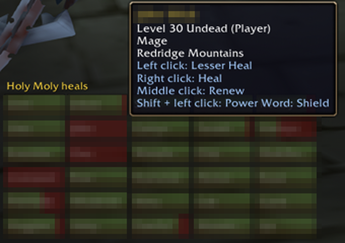
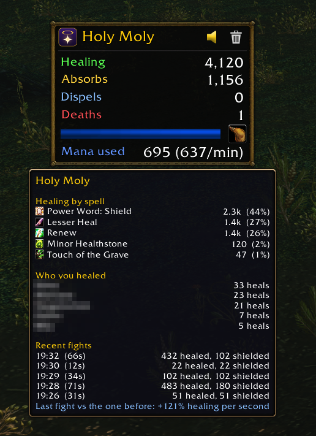
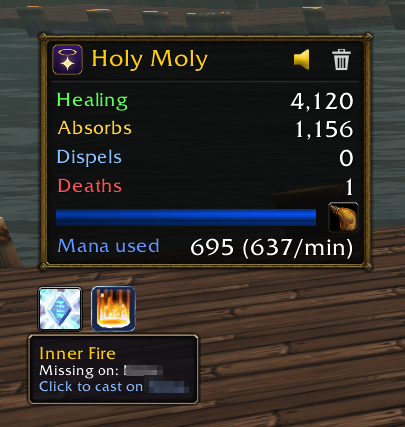
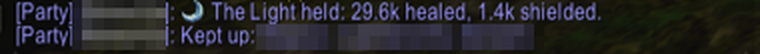

# Holy Moly

The Priest's companion for World of Warcraft: Forever (Blizzard, launches 4 Nov 2026). Forever only: the TOC
loads it on the Forever client and nowhere else, and the code is built around Forever's addon rules.

## What it does

- **The box:** your healing, absorbs, dispels and group deaths since the last reset (from Blizzard's built-in
  damage meter), a mana bar that glows red when mana runs low, and the mana your spells cost in the current or
  last fight, with mana per minute. Drag it to move it; the trash button resets the totals (and Blizzard's
  meter) after asking.
- **Hover the box:** healing per spell with icons, shares and overheal, who you healed and how often, and your
  recent fights with a comparison to the one before.
- **Speaker button:** sends your totals in one of a few Priest lines, then the three others you healed most
  ("Kept up: ...", by first name), as a yell, a say or to group chat. Out of combat only, never when both totals
  are 0.
- **Drink button** on the mana bar: yells a "wait, I need to drink" line with your mana percent.
- **Timers panel** under the box: debuffs you can dispel (red border), then your Renews, shields, other HoTs and
  Weakened Soul on each group member, as icons with the game's own cooldown sweep.
- **Buff check:** out of combat, buttons for Priest buffs someone in the group is missing or has under 5 minutes
  left on (Fortitude, Divine Spirit, Shadow Protection, Inner Fire, Fear Ward); a click casts it on the first one
  who needs it, missing before running out.
- **Heal buttons:** a grid of your party or raid, one button per person with name and health bar. Faint while
  they are fine, a red border under 30% health (Forever hides health from addons, so the game itself applies the
  threshold). Left click casts Flash Heal, right click Greater Heal (or the biggest heal you know), middle click Renew,
  Shift + left click Power Word: Shield, in combat too; each click can be changed in the settings.
  The tank has a blue border and a shield mark: the tank role from the group finder, a raid's main tank, or whoever
  you mark with `/holy tank` (target them first; again to unmark, `/holy tank clear` to clear all).
  It has its own position and size: drag it by its title, set its size in the settings apart from the box.
- **Minimap button:** a click shows or hides the box, a right-click opens the settings; drag it around the
  minimap.
- **Settings:** Options > AddOns > Holy Moly, `/holy config`, or right-click the minimap button or Holy Moly in the
  minimap's addon menu. `/holy reset | show | hide` also work; `/holy check`
  prints what each heal-button click is set to and, for a minute, the spell and rank each click really casts.

## Screenshots

In a raid: the heal buttons for all 40 with the click spells in the tooltip, the timers panel and the box.



| | |
|---|---|
|  |  |
| Hover the box after a fight: healing per spell, who you healed, recent fights. | In a party: the box, the timers panel, a buff check button and the heal buttons. |
|  |  |
| Buff check: a missing Inner Fire, one click to cast it. | Heal buttons: missing health in red, the click spells on hover. |

The speaker button's report in party chat and the "kept up" line:



## Support

Holy Moly is free. If it keeps your group alive and you want to say thanks: [paypal.me/nim4k](https://paypal.me/nim4k).

## Layout

| Path | What |
|---|---|
| `HolyMoly/` | The addon. `Settings.lua` (saved variables and the options page, loads first), `HolyMoly.lua` (box, totals, tooltip, report), `Mana.lua`, `HotTimers.lua`, `BuffCheck.lua`, `HealGrid.lua`, `MinimapButton.lua`, `Media/` (logo and trash icon) |
| `tools/make_icons.py` | Draws `Media/Icon.tga` (the logo) and `Media/Trash.tga` |
| `tools/package.sh`, `.github/workflows/release.yml` | The release zip and the tag-triggered GitHub release; steps in [docs/PUBLISHING.md](docs/PUBLISHING.md) |
| `CHANGELOG.md`, `LICENSE` | Release notes per version; MIT |
| `docs/screenshots/` | Screenshots from the Forever beta, used here and on CurseForge |
| `docs/research/priest-addons.md` | What other Priest addons do, what is feasible in Forever, the feature backlog |
| `reference/` | Offline developer references (below) |

To play it from a clone, link or copy `HolyMoly/` into the client's `Interface/AddOns/` (the Forever beta lives in
`_classic_beta_`) and restart the client.

## Target client

| | |
|---|---|
| TOC | `## Interface: 16001` (Forever beta 1.60.1) |
| Game type | `## AllowLoadGameType: forever` (internal name `camelot`) |
| `WOW_PROJECT_ID` | `18` (`WOW_PROJECT_CAMELOT`) |
| UI and API | Mainline (retail) UI, most APIs from 12.1.5 |
| Check in game | `/dump select(4, GetBuildInfo())` |

Forever keeps the Midnight addon restrictions: in combat many values reach addon code as **secret values**
(for example `UnitHealth`). Addon code can hand them to widgets such as `StatusBar:SetValue`, but cannot compare,
do math on or print them. `COMBAT_LOG_EVENT_UNFILTERED` is not available to addons. Before using an API, look it
up in [reference/api/secret-values.md](reference/api/secret-values.md).

Forever quirks found so far: `UnitName("player")` returns the first and last name apart (`"Nima", "Ka"`) while
cast targets name people in full (`"Nima Ka"`); a single `|` in a chat message makes the server drop it (write
`||`); /say, /yell and /emote from addons outside instances only work straight from a click.

## References

| Path | What | Source |
|---|---|---|
| [reference/api/](reference/api/README.md) | Every API system, function, event, enum and widget method, with its secret-value flags, as markdown; `api.json` holds the same data for tooling | Generated from Blizzard's own API documentation |
| [reference/api/secret-values.md](reference/api/secret-values.md) | Every function and event whose values can be secret | Generated |
| [reference/api/events.md](reference/api/events.md) | Every event with its payload | Generated |
| `reference/wow-ui-source/` | Blizzard's UI code for the Forever client (FrameXML, Blizzard addons, API docs). Read it to see how Blizzard's own frames do things | Git submodule, `forever` branch of [Gethe/wow-ui-source](https://github.com/Gethe/wow-ui-source) |
| `reference/wiki/` | Guide pages: getting started, TOC format, events, saved variables, widget API, secret values, secure templates and taint, and the API change logs for Forever 1.60.1 and Midnight 12.0.0 to 12.1.5 | [warcraft.wiki.gg](https://warcraft.wiki.gg), CC BY-SA 4.0 |
| `reference/blizzard/` | Blizzard's WoW Forever beta development notes thread | [Blizzard forums](https://us.forums.blizzard.com/en/wow/t/2360696) |

## Refresh after a new Forever build

```sh
git submodule update --init --remote reference/wow-ui-source   # newest forever branch
python3 tools/gen_api_reference.py                              # rebuild reference/api/
python3 tools/fetch_docs.py                                     # re-fetch wiki pages and Blizzard notes
```

Each generated file names the build it came from. Add a wiki page to `PAGES` in `tools/fetch_docs.py` to keep
it here as well. A fresh clone needs `git clone --recurse-submodules`.
