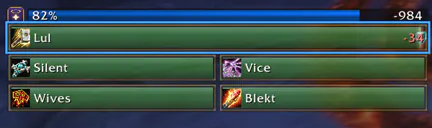
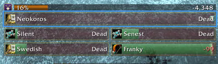
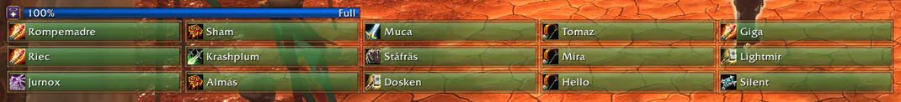
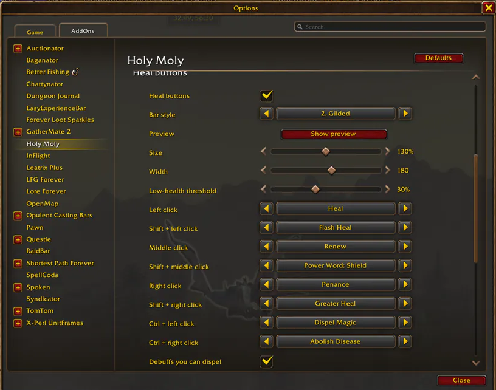
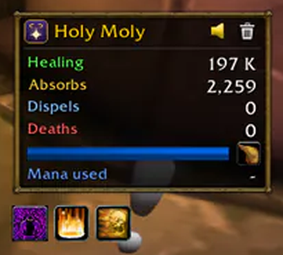
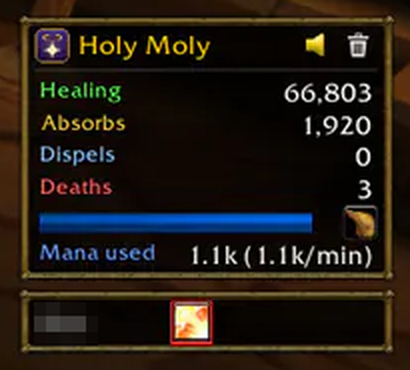
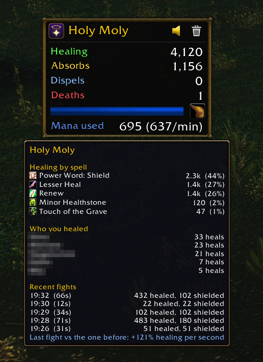
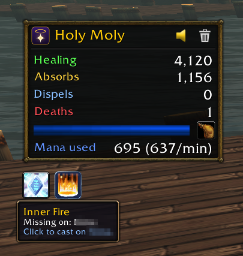
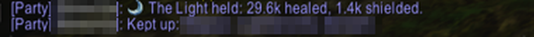

# Holy Moly

The Priest's companion for World of Warcraft: Forever (Blizzard, launches 4 Nov 2026). Forever only: the TOC
loads it on the Forever client and nowhere else, and the code is built around Forever's addon rules.

## What it does

- **The box:** your healing, absorbs, dispels and group deaths since the last reset (from Blizzard's built-in
  damage meter), a mana bar that glows red when mana runs low, and the mana your spells cost in the current or
  last fight, with mana per minute. Drag it to move it; the trash button resets the totals (and Blizzard's
  meter) after asking.
- **Hold Alt over the box:** healing per spell with icons, shares and overheal, who you healed and how often, and your
  recent fights with a comparison to the one before.
- **Social row** along the bottom of the box: S, Y, P and R pick Say, Yell, Party or Raid (instance chat in a finder
  group, party chat outside a raid), then four buttons send one short random line each, 20 of each kind, never the
  same twice in a row, with the star raid icon: **Report** (your healing, with a joke), **Bill** (the invoice: healing,
  the mana it cost, tips and potions welcome), **Thanks** (for the end of a good run) and **Drink** (wait for me, with
  your mana percent when it can be read). Some lines name the three others you healed most, as [A, B, C]. Report and
  Bill wait for the end of the fight; Thanks and Drink work any time.
- **Low mana after a fight:** when a fight ends with your mana under the low-mana threshold, a line in group chat
  asks them to wait before the next pull, with the /oom emote (both settings).
- **Timers panel** under the box: debuffs you can dispel (red border), then your Renews, shields, other HoTs and
  Weakened Soul on each group member, as icons with the game's own cooldown sweep.
- **Buff check:** out of combat, buttons for Priest buffs someone in the group is missing or has under 5 minutes
  left on (Fortitude, Divine Spirit, Shadow Protection, Inner Fire, Fear Ward); a click casts it on the first one
  who needs it, missing before running out.
- **Heal buttons:** a grid of your party or raid, one button per person with class icon, name, health bar and
  the health they are missing ("-600", nothing at full health); the width is a setting. Faint while
  they are fine, a red border under 30% health (Forever hides health from addons, so the game itself applies the
  threshold). Nine clicks, in combat too: left Flash Heal, Shift + left Lesser Heal, middle Renew, Shift + middle
  Power Word: Shield, right Penance (the biggest heal until you learn it), Shift + right the biggest heal you know,
  Ctrl + left Dispel Magic, Ctrl + right Abolish Disease (Cure Disease until you learn it), and Alt + left "come
  close": it sends "<name>, come close to me! You are out of my range!" to the chat the box's S, Y, P and R letters
  pick (Yell by default; boss fights may block Say and Yell, Party still works). Each can be changed in the settings.
  Hold Alt over a button for its tooltip (who it is, what each click does).
  A button turns gray while that person is beyond about 40 yards, the range of your heals, also in combat ("Gray when
  out of range" in the settings).
  A debuff you can dispel shows on the button, also in combat: a glow around it in the debuff's color (Magic blue,
  Disease brown, Curse purple, Poison green) and up to three of their icons with the time left, left of the
  missing-health text. The game draws them itself (Forever hides debuffs from addons in combat); "Debuffs you can
  dispel" in the settings turns them off.
  Your own mana sits on the top row, above the tank: blue, orange under the low-mana threshold, with your mana
  percent and what's missing ("-850", or "Full").
- **Mana bar:** the same mana bar on its own, in and out of a group: drag it anywhere, set its width, or turn it
  (and the heal buttons' one) off in the settings' Mana section.
  Three bar styles: Classic, Gilded (a textured bar in a thin gold frame, a spark at the edge of the health, a gold
  flash when your heal lands) and Gilded with class colors. Shift-click the minimap button or `/holy heals` turns
  the heal buttons on or off. The settings' Preview button shows a sample party in the chosen style beside the
  settings; `/holy preview` shows it where the heal buttons sit, for screenshots.
  The tank has a blue border and a shield mark: the tank role from the group finder, a raid's main tank, or whoever
  you mark with `/holy tank` (target them first; again to unmark, `/holy tank clear` to clear all).
  Each shows health and percent; in a party the tank has the first row to themselves, the rest two by two.
  Weakened Soul shows at the left of a button with its countdown, so you see when you can shield them again.
  It has its own position and size: drag it by the small Holy Moly icon at its top left, set its size in the settings apart from the box.
- **Minimap button:** a click shows or hides the box, a right-click opens the settings; drag it around the
  minimap.
- **Settings:** Options > AddOns > Holy Moly, `/holy config`, or right-click the minimap button or Holy Moly in the
  minimap's addon menu. `/holy reset | show | hide` also work; `/holy check`
  prints what each heal-button click is set to and, for a minute, the spell and rank each click really casts.

## Screenshots

From WoW Forever at level 58 (22 Nov 2026).

Stratholme: the heal buttons for a party. The tank has the first row to themselves (blue border, shield mark), each
button shows the health they are missing ("-37"), and your mana sits on top.



After a wipe: "Dead" on each button, and your mana turns orange under the low-mana threshold.



A 15-player battleground (Darkspear Islands): everyone, five to a row.



The heal-button settings (Options > AddOns > Holy Moly): bar style, size, width, the low-health threshold and what
each click casts, with Ctrl + left and Ctrl + right for the dispels.



| | |
|---|---|
|  |  |
| The box after a few dungeons, buff check buttons under it. | The box and the timers panel: a debuff you can dispel, red border. |
|  |  |
| Alt + hover the box after a fight: healing per spell, who you healed, recent fights. | Buff check: a missing Inner Fire, one click to cast it. |

The speaker button's report in party chat and the "kept up" line:



Names are blurred only in the older screenshots (the box, timers, tooltip, buff check and report, 10-11 Nov 2026).

## Support

Holy Moly is free. If it keeps your group alive and you want to say thanks: [paypal.me/nim4k](https://paypal.me/nim4k).

## Layout

| Path | What |
|---|---|
| `HolyMoly/` | The addon. `Settings.lua` (saved variables and the options page, loads first), `HolyMoly.lua` (box, totals, tooltip, report), `Mana.lua`, `HotTimers.lua`, `BuffCheck.lua`, `HealGrid.lua` (and `HealGrid.xml`, the debuff icon template), `MinimapButton.lua`, `Media/` (logo and trash icon) |
| `tools/make_icons.py` | Draws `Media/Icon.tga` (the logo) and `Media/Trash.tga` |
| `tools/package.sh`, `.github/workflows/release.yml` | The release zip and the tag-triggered GitHub release; steps in [docs/PUBLISHING.md](docs/PUBLISHING.md) |
| `CHANGELOG.md`, `LICENSE` | Release notes per version; MIT |
| `docs/screenshots/` | Screenshots from the Forever beta and launch (player names blurred), used here and on CurseForge |
| `docs/research/priest-addons.md` | What other Priest addons do, what is feasible in Forever, the feature backlog |
| `reference/` | Offline developer references (below) |

To play it from a clone, link or copy `HolyMoly/` into the client's `Interface/AddOns/` (the Forever beta lives in
`_classic_beta_`) and restart the client.

## Target client

| | |
|---|---|
| TOC | `## Interface: 16001` (Forever beta 1.60.1) |
| Game type | `## AllowLoadGameType: forever` (internal name `camelot`) |
| `WOW_PROJECT_ID` | `18` (`WOW_PROJECT_CAMELOT`) |
| UI and API | Mainline (retail) UI, most APIs from 12.1.5 |
| Check in game | `/dump select(4, GetBuildInfo())` |

Forever keeps the Midnight addon restrictions: in combat many values reach addon code as **secret values**
(for example `UnitHealth`). Addon code can hand them to widgets such as `StatusBar:SetValue`, but cannot compare,
do math on or print them. `COMBAT_LOG_EVENT_UNFILTERED` is not available to addons. Before using an API, look it
up in [reference/api/secret-values.md](reference/api/secret-values.md).

Forever quirks found so far: `UnitName("player")` returns the first and last name apart (`"Nima", "Ka"`) while
cast targets name people in full (`"Nima Ka"`); a single `|` in a chat message makes the server drop it (write
`||`); /say, /yell and /emote from addons outside instances only work straight from a click.

## References

| Path | What | Source |
|---|---|---|
| [reference/api/](reference/api/README.md) | Every API system, function, event, enum and widget method, with its secret-value flags, as markdown; `api.json` holds the same data for tooling | Generated from Blizzard's own API documentation |
| [reference/api/secret-values.md](reference/api/secret-values.md) | Every function and event whose values can be secret | Generated |
| [reference/api/events.md](reference/api/events.md) | Every event with its payload | Generated |
| `reference/wow-ui-source/` | Blizzard's UI code for the Forever client (FrameXML, Blizzard addons, API docs). Read it to see how Blizzard's own frames do things | Git submodule, `forever` branch of [Gethe/wow-ui-source](https://github.com/Gethe/wow-ui-source) |
| `reference/wiki/` | Guide pages: getting started, TOC format, events, saved variables, widget API, secret values, secure templates and taint, and the API change logs for Forever 1.60.1 and Midnight 12.0.0 to 12.1.5 | [warcraft.wiki.gg](https://warcraft.wiki.gg), CC BY-SA 4.0 |
| `reference/blizzard/` | Blizzard's WoW Forever beta development notes thread; `tools/fetch_docs.py` saves it locally, it is not committed (gitignored) | [Blizzard forums](https://us.forums.blizzard.com/en/wow/t/2360696) |

## Refresh after a new Forever build

```sh
git submodule update --init --remote reference/wow-ui-source   # newest forever branch
python3 tools/gen_api_reference.py                              # rebuild reference/api/
python3 tools/fetch_docs.py                                     # re-fetch wiki pages and Blizzard notes
```

Each generated file names the build it came from. Add a wiki page to `PAGES` in `tools/fetch_docs.py` to keep
it here as well. A fresh clone needs `git clone --recurse-submodules`.
